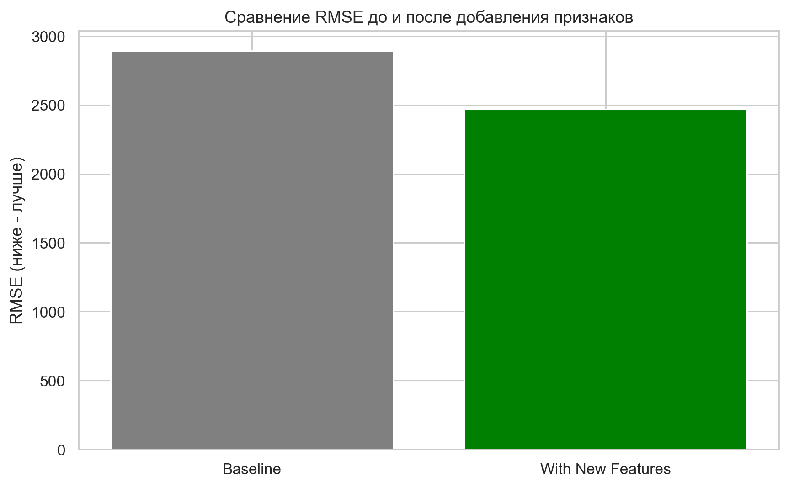
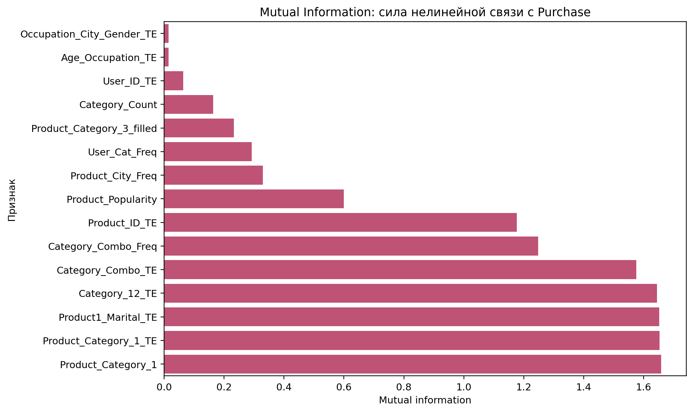

# Black Friday · Purchase Prediction

Предсказание суммы покупки по данным о покупателе и товаре. Учебный ML-проект: исследовательская аналитика, создание и отбор признаков, сравнение градиентных бустингов и ансамбль прогнозов.

[Ноутбук](Black_Friday.ipynb) · [Python-пайплайн](black_friday_pipeline.py) · [Данные](data/README.md)



## Что сделано

- Анализ покупок по возрасту, полу, городу, категориям товаров и активности покупателей.
- Категориальные признаки, частоты, взаимодействия, агрегаты и target encoding.
- Статистическое ранжирование признаков и анализ важностей.
- Baseline HistGradientBoosting, LightGBM, XGBoost и доступный в пайплайне CatBoost.
- Кросс-валидация, сравнение RMSE / R² / MAPE, подбор весов смеси и формирование submission.



## Сохранённые результаты

Ниже — результаты **исходного запуска**, сохранённые в ноутбуке. При публикации модели заново не обучались.

| Модель | OOF RMSE ↓ | R² ↑ | MAPE, % ↓ |
|---|---:|---:|---:|
| Baseline HGB | 2 892,49 | 0,6684 | 35,31 |
| LightGBM | 2 471,02 | 0,7580 | 27,86 |
| XGBoost | 2 481,85 | 0,7559 | 27,91 |
| Ансамбль: 75% LightGBM + 25% XGBoost | 2 469,91 | 0,7582 | 27,79 |

**Границы интерпретации.** В предоставленном коде target encoding и отбор признаков выполняются до внешней CV. Это может приводить к утечке информации между фолдами. Веса ансамбля выбраны на тех же OOF-прогнозах, на которых измерено качество; частотные признаки используют train вместе с test. Поэтому эти числа описывают исследовательский эксперимент и не являются независимой оценкой качества на новых данных. Для строгой проверки все обучаемые преобразования нужно перенести внутрь внешних фолдов и отдельно проверить итоговую модель на отложенной выборке.

## Локальный запуск

Нужен Python 3.10+; разумно использовать отдельное окружение. Диапазоны в `requirements.txt` не являются lock-файлом исходного запуска.

```bash
python -m venv .venv
source .venv/bin/activate  # Windows: .venv\Scripts\activate
python -m pip install -r requirements.txt
```

Положите данные в `data/train.csv` и `data/test.csv`, затем:

```bash
python black_friday_pipeline.py --train data/train.csv --test data/test.csv --output output/black_friday
```

Или откройте из корня репозитория:

```bash
jupyter lab Black_Friday.ipynb
```

Ноутбук использует `black_friday_pipeline.py` из той же папки. Путь к данным можно изменить переменной окружения `BLACK_FRIDAY_DATA_DIR`. Результаты сохраняются в `output/black_friday/`; при наличии `results.json` ноутбук использует сохранённый результат — для нового обучения выберите новую выходную папку или переместите старый результат.

## Colab

В пустом Colab-ноутбуке выполните:

```python
!git clone https://github.com/Pernya/black-friday-purchase-prediction.git
%cd black-friday-purchase-prediction
%pip install -r requirements.txt
```

Загрузите CSV в `data/` и вызовите CLI из ячейки с `!python black_friday_pipeline.py ...`. Длительность обучения зависит от CPU и состава установленных моделей. Полный запуск в Colab при публикации не проверялся.

## Структура и проверка

- `Black_Friday.ipynb` — основной аналитический документ с сохранёнными результатами.
- `black_friday_pipeline.py` — код обработки, обучения и формирования submission.
- `assets/` — два графика из исходного ноутбука.
- `data/README.md` — ожидаемые входные файлы.
- `publication.json` — происхождение ноутбука и статус выполнения.

В публикацию включены основные файлы; датасеты, обученные модели, промежуточные выгрузки и черновики не входят.

```bash
python -m pip install -r requirements-validation.txt
python scripts/validate.py
```

GitHub Actions проверяет формат ноутбука и синтаксис кода. Эта проверка не запускает обучение и не подтверждает качество прогнозов.
