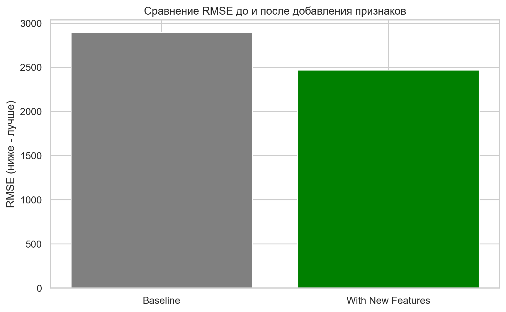
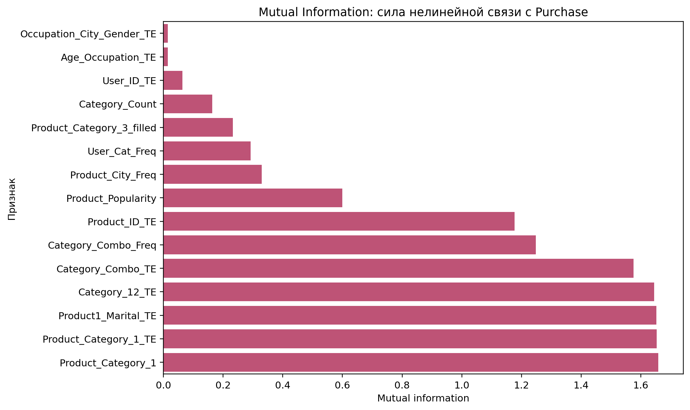

# Black Friday — прогноз суммы покупки

[](https://github.com/Pernya/black-friday-purchase-prediction/actions/workflows/validate.yml)

Учебный проект о том, как информация о покупателе и товаре помогает предсказывать расходы. В работе соединены исследование данных, создание и отбор признаков, сравнение бустингов и ансамбль прогнозов.

**[Читать ноутбук →](Black_Friday.ipynb)** · [Посмотреть Python-пайплайн](black_friday_pipeline.py) · [Подготовить данные](data/README.md) · [Документация](docs/PROJECT_GUIDE.md)

## Результат эксперимента

В исходном запуске RMSE снизилась с **2 892,49** у базовой модели до **2 469,91** у ансамбля. Основное улучшение дали продвинутые модели и признаки; преимущество смеси перед отдельным LightGBM оказалось небольшим.

| Модель | RMSE ↓ | R² ↑ | MAPE, % ↓ |
|---|---:|---:|---:|
| HistGradientBoosting — базовый ориентир | 2 892,49 | 0,6684 | 35,31 |
| LightGBM | 2 471,02 | 0,7580 | 27,86 |
| XGBoost | 2 481,85 | 0,7559 | 27,91 |
| 75% LightGBM + 25% XGBoost | **2 469,91** | **0,7582** | **27,79** |

**Как читать оценку.** Это сохранённые OOF-результаты исследовательского запуска. Кодирование по целевой переменной и отбор признаков выполнены до внешней кросс-валидации, поэтому качество может быть завышено. Веса ансамбля выбраны на тех же OOF-прогнозах. Независимый тест этих результатов не проведён.



## Как устроено решение

1. **Данные.** Одна строка — покупка; целевая переменная `Purchase` — её сумма. Проверяем пропуски и различия между группами покупателей и товаров.
2. **Признаки.** Добавляем частоты, сочетания категорий и агрегаты. Итоговый набор содержит 27 признаков.
3. **Отбор.** Сопоставляем статистический рейтинг с предметными гипотезами. Рейтинг зависимости сам по себе не доказывает полезность признака для прогноза.
4. **Модели.** Сравниваем базовый алгоритм с бустингами на пяти фолдах, затем подбираем веса смеси.
5. **Результат.** Сохраняем прогнозы, таблицы метрик и диагностику ошибок.

RMSE измеряет ошибку в единицах суммы покупки; большие промахи получают больший штраф. R² сравнивает модель с прогнозом средним, MAPE показывает относительную ошибку в процентах.

<details>
<summary>Посмотреть статистический рейтинг признаков</summary>



Высокое место показывает связь с суммой покупки. Для проверки вклада в качество нужен отдельный эксперимент внутри корректной схемы валидации.

</details>

## Повторить локально

Нужен Python 3.10+. Из корня клонированного репозитория:

```bash
python -m venv .venv
source .venv/bin/activate  # Windows: .venv\Scripts\activate
python -m pip install -r requirements.txt
```

Положите CSV в `data/train.csv` и `data/test.csv`, затем выберите удобный способ:

```bash
# Последовательное чтение и запуск в Jupyter
jupyter lab Black_Friday.ipynb

# Полное обучение через командную строку
python black_friday_pipeline.py --train data/train.csv --test data/test.csv --output output/black_friday
```

Ноутбук импортирует `black_friday_pipeline.py` из той же папки. Для другого расположения данных задайте `BLACK_FRIDAY_DATA_DIR`. Результаты появляются в `output/black_friday/`. Если там уже есть `results.json`, ноутбук использует его; для нового эксперимента измените `OUTPUT_ROOT`.

<details>
<summary>Запустить пайплайн в Google Colab</summary>

В пустом Colab-ноутбуке:

```python
!git clone https://github.com/Pernya/black-friday-purchase-prediction.git
%cd black-friday-purchase-prediction
%pip install -r requirements.txt
```

Загрузите CSV в `data/`, затем выполните:

```python
!python black_friday_pipeline.py --train data/train.csv --test data/test.csv --output output/black_friday
```

Длительность зависит от CPU и набора установленных моделей. Полный запуск в Colab при подготовке публикации не проверялся.

</details>

## Что важно для воспроизведения

Частотные признаки используют объединение train и test. Для строгой оценки кодирование и отбор нужно перенести внутрь внешних фолдов, а ансамбль проверить на отдельной выборке.

В репозитории — основной ноутбук, его Python-модуль и графики. Датасеты и обученные модели не включены. `requirements.txt` содержит диапазоны версий, а не зафиксированное окружение прежнего запуска. Происхождение файла и статус выполнения записаны в [publication.json](publication.json).

**Проверка оформления и кода:** `python -m pip install -r requirements-validation.txt`, затем `python scripts/validate.py`. GitHub Actions выполняет ту же проверку структуры и синтаксиса. Полное обучение при редакторской правке не запускалось; вычислительная логика и сохранённые результаты не изменены.
