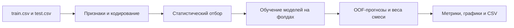

# Руководство по проекту Black Friday

[← Главная страница](../README.md) · [Ноутбук](../Black_Friday.ipynb) · [Код пайплайна](../black_friday_pipeline.py)

Документация описывает опубликованный код и сохранённый исследовательский эксперимент. Актуализирована 18 ноября 2026 года. Полное обучение при подготовке документации не выполнялось.

## Содержание

1. [Задача и результат](#purpose)
2. [Данные](#data)
3. [Архитектура и функции](#architecture)
4. [Признаки и модели](#models)
5. [Как оценено качество](#validation)
6. [Установка и запуск](#run)
7. [Настройки](#settings)
8. [Выходные файлы](#outputs)
9. [Ошибки и дальнейшая работа](#troubleshooting)

<a id="purpose"></a>

## 1. Задача и результат

Проект решает задачу регрессии: по информации о покупателе и товаре предсказывает сумму покупки `Purchase`. Пользователь решения — аналитик, изучающий признаки покупательского поведения и качество разных алгоритмов.

Основная метрика — RMSE. Она измеряется в единицах суммы покупки; крупные ошибки влияют на неё сильнее мелких. В сохранённом эксперименте baseline получил RMSE **2 892,49**, LightGBM — **2 471,02**, смесь 75% LightGBM и 25% XGBoost — **2 469,91**. Разница смеси и LightGBM около 1,11 мала по сравнению с улучшением относительно baseline.

Эти числа описывают исходный эксперимент, а не независимый тест нового развёртывания. Ограничения процедуры оценки приведены в разделе 5.

<a id="data"></a>

## 2. Данные

Одна строка — одна покупка. Вход состоит из двух CSV:

| Файл | Назначение | Обязательное отличие |
|---|---|---|
| `train.csv` | Обучение и оценка | Есть `Purchase` |
| `test.csv` | Строки для прогноза | Цель не используется |

Основные поля:

| Поле | Роль |
|---|---|
| `User_ID`, `Product_ID` | Идентификаторы покупателя и товара; основа частотных признаков |
| `Gender`, `Age`, `Occupation` | Характеристики покупателя |
| `City_Category`, `Stay_In_Current_City_Years` | Группа города и срок проживания |
| `Marital_Status` | Категориальная характеристика покупателя |
| `Product_Category_1`, `Product_Category_2`, `Product_Category_3` | Категории товара, включая неполные значения |
| `Purchase` | Числовая цель, сумма покупки |

Названия колонок должны совпадать с кодом. `load_data` использует обычный `pandas.read_csv` и не выполняет полноценную проверку схемы. Перед обучением проверьте наличие полей, числовую цель, пропуски и отсутствие случайной индексной колонки.

Исходные датасеты не входят в GitHub. [Памятка по размещению данных](../data/README.md). Не добавляйте произвольные новые строки или заменённые цели, если хотите сопоставлять результат с сохранённым экспериментом.

<a id="architecture"></a>

## 3. Архитектура и основные функции

Ноутбук служит аналитическим представлением, а `black_friday_pipeline.py` содержит обработку, обучение и сохранение результатов.



| Функция | Вход | Результат |
|---|---|---|
| `load_data` | Два пути `Path` | Обучающая и тестовая таблицы |
| `build_feature_frames` | Исходные таблицы | Таблицы с новыми признаками |
| `apply_target_encodings` | Таблицы признаков | Дополнительные кодировки категорий по цели |
| `compute_statistical_ranking` | Train, кандидаты, каталог графиков | Рейтинг признаков |
| `select_features` | Рейтинг и train | Согласованный список доступных колонок |
| `train_cv` | Фабрика модели, признаки, цель, test | Метрики, OOF, усреднённый тестовый прогноз и важности, если доступны |
| `optimize_blend` | Прогнозы кандидатов и цель | Веса смеси, OOF смеси, прогноз test и RMSE |
| `make_submission` | Тестовые признаки и прогноз | Основной и расширенный CSV |
| `run_pipeline` | Train, test, выходная папка | Все этапы и словарь результатов |

Для вызова из собственного Python-кода, после установки зависимостей:

```python
from pathlib import Path
from black_friday_pipeline import run_pipeline

results = run_pipeline(
    train_path=Path("data/train.csv"),
    test_path=Path("data/test.csv"),
    output_root=Path("output/experiment_01"),
)
print(results["ensemble"])
print(results["submission_paths"])
```

<a id="models"></a>

## 4. Признаки и модели

**Построчные признаки:** кодировки возраста, пола и города; заполненные категории и индикаторы их отсутствия; сочетания исходных категорий.

**Частотные признаки:** популярность товара, число покупок пользователя, количество уникальных товаров, частоты сочетаний пользователя, города и категории. Они строятся с использованием объединённых train и test: это трансдуктивная схема, зависящая от состава тестовой выборки.

**Target encoding:** категория заменяется сглаженной средней суммой покупки. Сглаживание подтягивает редкие категории к общей средней. `add_target_encoding` по умолчанию использует `smoothing=20.0`; для train создаются OOF-кодировки, для test — статистики полного train.

Отбор объединяет верхнюю часть статистического рейтинга с перечнем обязательных признаков. Поэтому `TOP_FEATURES=30` — размер рассматриваемой верхушки рейтинга, а не гарантия ровно 30 итоговых колонок. В сохранённом эксперименте было 27; новый запуск определяется текущими данными и кодом.

| Модель | Основные настройки в коде |
|---|---|
| HistGradientBoosting | `max_iter=300`, `max_depth=8`, `learning_rate=0.06` |
| LightGBM | `n_estimators=1000`, `num_leaves=127`, `learning_rate=0.05` |
| XGBoost | `n_estimators=500`, `max_depth=8`, `learning_rate=0.05`, `early_stopping_rounds=50` |
| CatBoost | `iterations=900`, `depth=8`, `learning_rate=0.05`, `l2_leaf_reg=3` |

XGBoost импортируется обязательно. LightGBM и CatBoost добавляются, если их импорт прошёл успешно. Установка разных наборов библиотек может изменить кандидатов и итоговые веса. В сохранённой таблице нет результата CatBoost, хотя текущий код содержит этот кандидат.

Смесь — взвешенная сумма прогнозов, а не стекинг с отдельной метамоделью. Для двух кандидатов веса перебираются с шагом 0,05; для трёх — по сетке 0,1 с суммой весов 1. Прогноз смеси ограничивается снизу минимальным `Purchase` в train. При записи submission дополнительно исключаются отрицательные значения и выполняется округление до целого.

<a id="validation"></a>

## 5. Как оценено качество

`N_SPLITS=5`, `RANDOM_STATE=42`. OOF означает: строка получает прогноз от модели, которая не обучалась непосредственно на этой строке. Тестовые прогнозы моделей фолдов усредняются.

Дополнительно считаются R² и MAPE. MAPE умножается на 100 и выводится в процентах; при нулевых или очень малых целях относительная ошибка плохо интерпретируется.

Текущая схема имеет ограничения:

1. Target encoding сделан до внешнего CV. OOF-кодирование на предыдущем этапе не исключает влияния целевых значений внешней проверки на признаки обучающих строк. Общая средняя также берётся по всему train.
2. Статистический отбор видит цель до внешнего разделения.
3. Веса смеси выбираются и оцениваются на одних OOF-прогнозах.
4. Частоты используют test, поэтому новый набор тестовых строк может изменить признаки.

Следовательно, опубликованный RMSE может быть оптимистичным. Для строгого сравнения нужны преобразования внутри внешних фолдов и отдельная оценка всей процедуры подбора.

В `run_pipeline` основной submission получает ансамбль, только если средний тестовый прогноз лежит между 0,5 и 1,5 среднего train. Иначе используется baseline. Это грубая проверка масштаба, **не статистический тест устойчивости**. Проверяйте `recommended_submission` в `results.json`, а не предполагайте, что основной CSV всегда содержит смесь.

Поле `best_importance_model` обозначает источник графика важностей: текущий код предпочитает LightGBM, если он доступен, иначе XGBoost. Это имя не подтверждает, что модель победила среди всех кандидатов по метрике.

<a id="run"></a>

## 6. Установка и запуск

### Локальный компьютер

```bash
git clone https://github.com/Pernya/black-friday-purchase-prediction.git
cd black-friday-purchase-prediction
python -m venv .venv
```

Активируйте окружение:

```bash
# macOS / Linux
source .venv/bin/activate
```

```powershell
# Windows PowerShell
.venv\Scripts\Activate.ps1
```

Затем:

```bash
python -m pip install -r requirements.txt
jupyter lab Black_Friday.ipynb
```

Нужен Python 3.10+. Разместите данные в `data/` и запускайте ноутбук из корня репозитория. Для запуска без интерфейса:

```bash
python black_friday_pipeline.py --train data/train.csv --test data/test.csv --output output/experiment_01
```

### Google Colab

В пустом ноутбуке клонируйте репозиторий, перейдите в него и установите зависимости:

```python
!git clone https://github.com/Pernya/black-friday-purchase-prediction.git
%cd black-friday-purchase-prediction
%pip install -r requirements.txt
```

Загрузите данные в `data/`, затем вызовите CLI из ячейки с префиксом `!`. Сохраните нужные CSV до завершения сессии. Полный запуск в Colab не подтверждён текущей публикацией.

### Повторный эксперимент

CLI запускает расчёт заново. Ноутбук может прочитать существующий `results.json` и пропустить тяжёлое обучение. Чтобы не перепутать результаты, используйте отдельный `output/experiment_02` и меняйте `OUTPUT_ROOT` в настройке ноутбука. Не переносите старый `results.json` отдельно от связанных файлов: он хранит пути к ним.

<a id="settings"></a>

## 7. Настройки

| Настройка | По умолчанию | Где менять |
|---|---|---|
| `--train`, `--test` | `data/train.csv`, `data/test.csv` | CLI |
| `--output` | `output/black_friday` | CLI |
| `BLACK_FRIDAY_DATA_DIR` | Папка `data/` | Окружение для ноутбука |
| `OUTPUT_ROOT` | `output/black_friday/` | Начальная ячейка ноутбука |
| `RANDOM_STATE` | 42 | Python-модуль |
| `N_SPLITS` | 5 | Python-модуль |
| `RANK_SAMPLE` | 30 000 | Python-модуль |
| `TOP_FEATURES` | 30 | Python-модуль |

Часть алгоритмов использует все доступные CPU (`n_jobs=-1`). Для общего компьютера количество потоков можно уменьшить в фабриках моделей. GPU для опубликованной конфигурации не требуется.

<a id="outputs"></a>

## 8. Выходные файлы

Файлы создаются после соответствующего этапа, а не поставляются готовым комплектом.

| Артефакт внутри выходного каталога | Содержание |
|---|---|
| `results.json` | Настройки результата, метрики, веса и ссылки на артефакты |
| `statistical_feature_ranking.csv` | Рейтинг кандидатов |
| `top_features.json` | Верхняя часть важностей выбранного для интерпретации алгоритма; не полный список входных признаков |
| `black_friday_submission.csv` | Рекомендуемый прогноз: `User_ID,Product_ID,Purchase` |
| `black_friday_submission_full.csv` | Та же таблица, дополненная `Comb`, если он есть |
| `black_friday_submission_baseline.csv` | Прогноз baseline |
| `black_friday_submission_experimental_ensemble.csv` | Прогноз смеси независимо от выбора рекомендуемого варианта |
| `figures/` | EDA, важности и диагностика ошибок |

`train_cv` также сохраняет массивы прогнозов и доступные важности; точные пути указаны в `model_results` файла `results.json`. Для baseline и экспериментального ансамбля создаются и расширенные версии CSV.

<a id="troubleshooting"></a>

## 9. Ошибки и дальнейшая работа

| Симптом | Проверить |
|---|---|
| `Dataset not found` | Путь и имена CSV; CLI принимает собственные имена через аргументы |
| Не найден `black_friday_pipeline` | Рабочая папка kernel должна быть корнем репозитория |
| Не найден `xgboost` | Зависимости установлены именно в выбранный kernel |
| LightGBM/CatBoost отсутствуют в сравнении | Прошёл ли импорт этих библиотек; сравните окружения |
| Ноутбук показывает прежние результаты | Наличие `results.json` и значение `OUTPUT_ROOT` |
| Новый RMSE отличается | Хеши данных, версии библиотек, список кандидатов, параметры и состав признаков |

Проверка структуры и синтаксиса:

```bash
python -m pip install -r requirements-validation.txt
python scripts/validate.py
```

Она не обучает модели и не проверяет численные результаты. Для воспроизведения сохраните версии зависимостей, хеши входных CSV и весь выходной каталог нового запуска. Главная методическая доработка — исправить границы кодирования и отбора, после чего повторно оценить полезность ансамбля.
